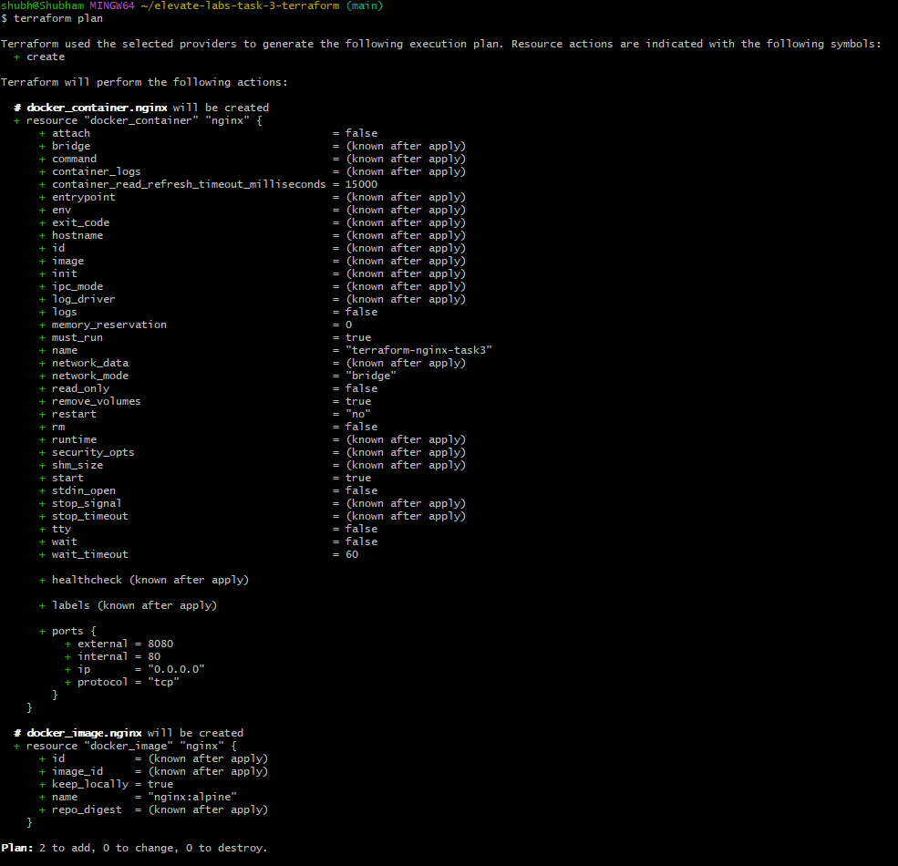
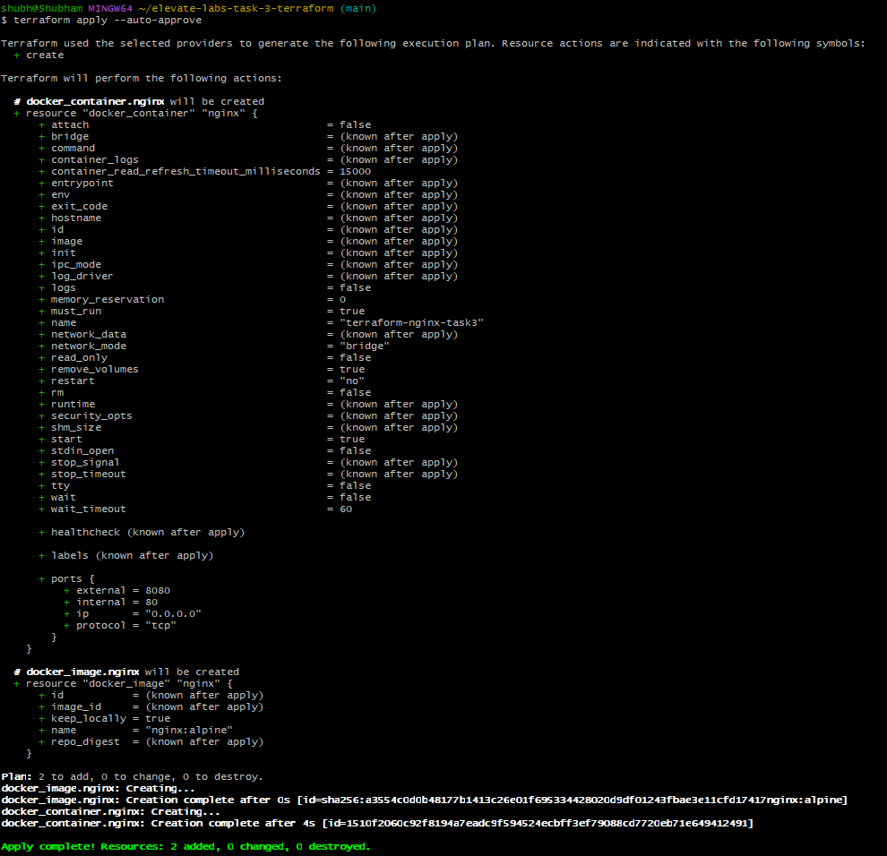
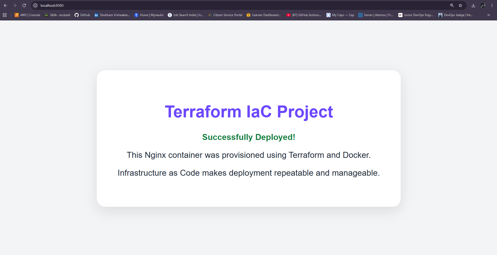
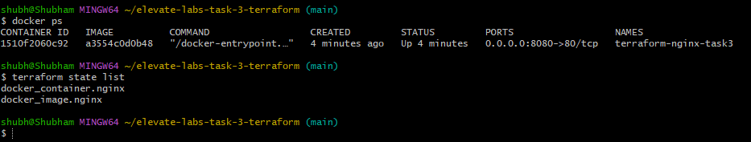
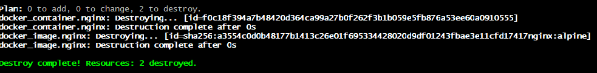

# Task 3: Infrastructure as Code (IaC) with Terraform

## Project Overview

This project demonstrates Infrastructure as Code (IaC) using Terraform and Docker. Terraform is used to provision an Nginx Docker container, verify the deployed resources, inspect Terraform state, and destroy the infrastructure when it is no longer needed.

## Tools Used

- Terraform
- Docker Desktop
- Docker provider for Terraform
- Nginx
- Git and GitHub
- Windows 11 and Git Bash


## Screenshots

### 1. Terraform Plan


### 2. Terraform Apply


### 3. Custom Nginx Website


### 4. Terraform State & Docker list


### 5. Terraform Destroy



## Project Structure

```text
elevate-labs-task-3-terraform/
├── main.tf
├── .gitignore
├── README.md
└── screenshots/
```

## How It Works

The Terraform configuration in `main.tf` defines the Docker provider, downloads the `nginx:alpine` image, and creates a container named `terraform-nginx-task3`.

Port `8080` on the local computer is mapped to port `80` inside the container.

## Execution Steps

Terraform Configuration Explained

The main.tf file defines the infrastructure Terraform manages.

a. Terraform and Provider Configuration

```text
terraform {
  required_providers {
    docker = {
      source  = "kreuzwerker/docker"
      version = "~> 3.0"
    }
  }
}

provider "docker" {
  host = "npipe:////.//pipe//docker_engine"
}
```

Explanation:

required_providers tells Terraform which provider plugin is needed.

kreuzwerker/docker is the Docker provider used to manage Docker resources.

version = "~> 3.0" specifies the compatible provider version range.

The provider "docker" block configures the connection to the Docker Engine.

The named pipe address is used to connect to Docker Desktop on Windows.

b. Docker Image Resource

```text
resource "docker_image" "nginx" {
  name         = "nginx:alpine"
  keep_locally = true
}
```
Explanation:

docker_image tells Terraform to manage a Docker image.

nginx is the Terraform resource's local name.

nginx:alpine identifies the Nginx image with the Alpine Linux base.

keep_locally = true requests that the image be retained locally when Terraform removes the image resource, where supported by the provider.

c. Docker Container Resource

```text
resource "docker_container" "nginx" {
  name  = "terraform-nginx-task3"
  image = docker_image.nginx.image_id

  ports {
    internal = 80
    external = 8080
  }

  volumes {
    host_path      = abspath("${path.module}/website")
    container_path = "/usr/share/nginx/html"
    read_only      = true
  }
}
```

Explanation:

docker_container defines the container Terraform will create.

name sets the Docker container name to terraform-nginx-task3.

image references the image resource declared above. Terraform understands this dependency and creates the image before the container.

internal = 80 specifies the port used by Nginx inside the container.

external = 8080 exposes Nginx through port 8080 on the local computer.

host_path points to the local website folder.

container_path mounts that folder at Nginx's default HTML directory.

read_only = true prevents the container from modifying the mounted website files.

The volume mount allows the custom website/index.html file to replace the default Nginx page without building a custom Docker image.

Custom Nginx Webpage

The website/index.html file contains the custom webpage displayed by the Nginx container.

The HTML defines the page content, while CSS styles the background, text, and content card. The page identifies the project as a Terraform IaC deployment.

Because the website directory is mounted into the container, Nginx serves the local HTML file from its web root.

After deployment, the webpage can be accessed at:

http://localhost:8080

Initialize the Terraform project:

```bash
terraform init
```

Format and validate the configuration:

```bash
terraform fmt
terraform validate
```

Preview the infrastructure changes:

```bash
terraform plan
```

Create the Docker resources:

```bash
terraform apply
```

Inspect the running container and Terraform state:

```bash
docker ps
terraform state list
```

Open `http://localhost:8080` in a browser to verify the Nginx welcome page.

Destroy the resources when finished:

```bash
terraform destroy
```

Confirm the destruction by checking Docker:

```bash
docker ps -a
```

## Screenshots and Execution Evidence

Execution screenshots are included in the `screenshots/` folder to demonstrate the Terraform workflow.

- Terraform initialization
- Terraform plan
- Successful Terraform apply
- Terraform state inspection
- Running Nginx container
- Successful Terraform destroy

## Key Learnings

- Understanding Infrastructure as Code (IaC)
- Using Terraform providers and resources
- Executing `terraform init`, `plan`, `apply`, and `destroy`
- Understanding Terraform state
- Provisioning and managing Docker containers through Terraform

## Conclusion

Successfully used Terraform to provision and manage a local Docker container. Verified the deployment, inspected Terraform state, and destroyed the provisioned resources.

This project demonstrates the basic infrastructure lifecycle using Infrastructure as Code.

